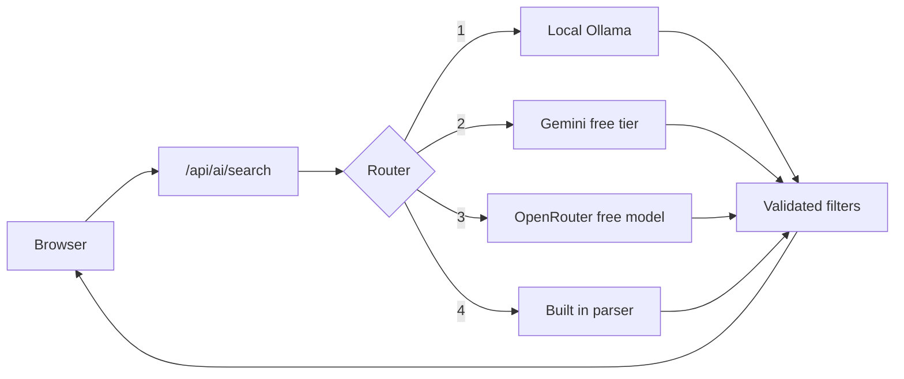

<div align="center">

# NyumbaGO

**Find a rental in Kenya that fits your budget, and walk through it in 360 before you visit.**


</div>

## Why this exists

House hunting in Kenya often means long trips to see places that do not match the listing. NyumbaGO puts the budget first, shows only what you can afford, and lets you tour verified properties in 360 degrees through Viewora before you spend a shilling on transport.

## Features

- **Budget first search.** Set a monthly budget in KSh and see how far under or over each listing sits.
- **Smart Search.** Type "1 bedroom in Kilimani under 40k with 360 tour" and the filters fill themselves.
- **360 degree tours.** Viewora tour links are validated before a listing can use them, and broken tours are flagged.
- **Interactive Kenya map.** Pins show tour status and budget fit across Nairobi, Mombasa, Kisumu, Nakuru and Eldoret.
- **Four roles.** Hunter, Landlord, Agent and Admin each get their own screens, including bulk tools for agents and a moderation panel.
- **Compare and save.** Shortlist listings and compare them side by side.
- **English and Kiswahili.**
- **Privacy and safety built in.** 18+ age gate, consent records, cookie preferences, listing reports, user blocking and data request handling aligned to the Kenya Data Protection Act, 2019.

## Screenshots

### Smart Search


### Map view


> Listing photos appear as grey placeholders in these screenshots. The real photos load from Unsplash when you run the app with internet access.

## Quick start

You need Node.js 20 or newer.

```bash
git clone https://github.com/YOUR_USERNAME/nyumbago.git
cd nyumbago
npm install
cp .env.example .env
npm run dev
```

Open http://localhost:3000.

The app works with no keys. Without an AI model, Smart Search uses a built in parser. Without Supabase, data saves in your browser.

## Smart Search and the AI router

Smart Search sends your sentence to a small server route. The server tries free options first and always has a fallback, so search never breaks.



Model output is validated before it touches your filters. Cities must match the supported list, and numbers are range checked.

### Turn on a free model

| Option | Setup |
| --- | --- |
| Local model, no quota | Install [Ollama](https://ollama.com), then run `ollama pull qwen2.5:3b` (about 2 GB) |
| Gemini free tier | Set `GEMINI_API_KEY` in `.env` |
| OpenRouter free model | Set `OPENROUTER_API_KEY` in `.env` |

Check what works with a real test call:

```bash
npm run ai:status
```

Free tier limits and model names change. Check each provider's page.

### Spending control

Paid providers stay off by default. They run only if you set `MONTHLY_BUDGET_USD` above 0, add the key and copy current prices into the `*_USD_PER_M` variables. Requests stop when the budget is reached. View usage at `/api/ai/usage`.

## Configuration

| Variable | Purpose | Default |
| --- | --- | --- |
| `PROVIDER_ORDER` | Router order | `local,gemini,openrouter` |
| `LOCAL_MODEL_URL` | Ollama address | `http://localhost:11434` |
| `LOCAL_MODEL` | Local model name | `qwen2.5:3b` |
| `GEMINI_API_KEY` | Gemini free tier key | empty |
| `OPENROUTER_API_KEY` | OpenRouter key | empty |
| `MONTHLY_BUDGET_USD` | Spend cap for paid providers | `0` |
| `AI_RATE_PER_MIN` | Requests per IP per minute | `20` |
| `VITE_SUPABASE_URL` | Supabase project URL | empty |
| `VITE_SUPABASE_ANON_KEY` | Supabase public key | empty |

Keep API keys in `.env`. Git ignores it. Never put a secret in a variable that starts with `VITE_`, because Vite sends those to the browser.

## Project structure

```
src/
  components/     Screens and modals (listings, map, dashboards, legal)
  lib/            Data layer, validation, translations, AI search client
server/
  index.ts        Express server and Vite middleware
  router.ts       Provider routing, budget and usage tracking
  search.ts       Smart Search parsing and validation
supabase/
  migrations/     Viewora and legal compliance schema
  functions/      validate-tour-url, check-broken-tours
docs/             Screenshots
```

## Database

Apply the files in `supabase/migrations` to your Supabase project, then set the two `VITE_SUPABASE_` variables. A rollback file is included for the legal compliance migration. Deploy the two edge functions in `supabase/functions` to validate Viewora links on the server.

## Deploy

```bash
npm run build
npm start
```

Set the same variables in your host's secrets panel.

## Status

NyumbaGO is an early build. The Viewora API integration is behind a feature flag and uses mock data. No real Viewora endpoint is called.

## Contributing

Open an issue before large changes. Keep pull requests small and run `npm run lint` first.

## License

